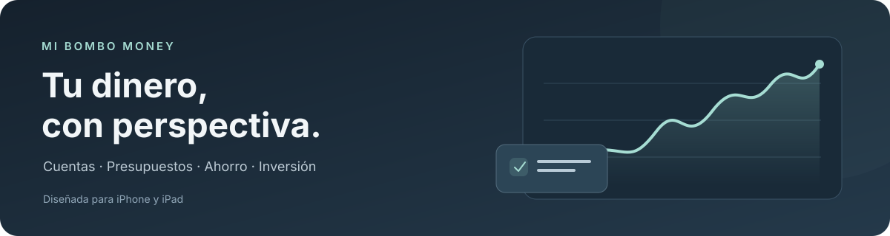

  

<h1 align="center">Mi Bombo Money</h1>

  Tus cuentas, tus objetivos y tus decisiones, en un mismo lugar. 
  Una app de finanzas personales para iPhone y iPad, construida con SwiftUI.

  
  
  
  

  <a href="#qué-puedes-hacer">Funciones</a> ·
  <a href="#ponerla-en-marcha">Empezar</a> ·
  <a href="#documentación">Documentación</a> ·
  <a href="https://github.com/Zenmilenario/Mi_Bombo_Money/actions">Comprobaciones</a>

---

## Qué puedes hacer

| Tu día a día | Lo que ofrece la app |
| --- | --- |
| **Ver dónde estás** | Patrimonio, dinero disponible, reservas y resumen mensual. |
| **Controlar tus cuentas** | Efectivo, ahorro, tarjetas vinculadas e inversiones, con saldos y valoraciones. |
| **Entender los movimientos** | Ingresos, gastos y transferencias, búsqueda, filtros y revisión de duplicados. |
| **Planificar el mes** | Presupuestos por categoría, repetición y opción de trasladar el sobrante. |
| **Apartar dinero con un propósito** | Reservas asociadas a tus cuentas que pueden acompañar a una transferencia propia. |
| **Reducir tareas repetidas** | Cargos periódicos, reglas de categorías y propuestas de clasificación mediante aprendizaje automático. |
| **Continuar en otro dispositivo** | Sincronización con Supabase y copia local para trabajar sin conexión. |

La interfaz se adapta al espacio disponible y al tamaño de letra. Incluye apariencia clara, oscura o del sistema, bloqueo con la autenticación del dispositivo y ocultación de importes.

## Conexión bancaria y aprendizaje

**Bancos.** La integración con Enable Banking consulta saldos y movimientos con autorización del titular. La conexión no permite realizar pagos. Las primeras descargas se revisan y concilian con lo ya registrado; la cobertura, los datos disponibles y las esperas dependen del banco y del proveedor. El laboratorio utiliza datos ficticios en un espacio separado.

**IA de categorías.** Un clasificador local aprende de ejemplos y de las confirmaciones del usuario para proponer categorías. Las propuestas requieren revisión; no equivalen a una contabilidad autónoma.

**Próxima entrega preparada localmente.** El reconocimiento de operaciones incorpora propuestas de Round up, Saveback y aportaciones a inversión. Permite corregir identificaciones y guardar condiciones por cuenta. Todavía no aplica automáticamente estos tipos a los saldos ni presupuestos. La compilación iOS y la prueba física de esta ampliación están pendientes.

Consulta el [alcance y la evaluación de los modelos](CloudBackend/APRENDIZAJE_CATEGORIAS.md) y la [integración bancaria personal](BankingBackend/INTEGRACION_PERSONAL.md).

## Ponerla en marcha

### Con un Mac

1. Abre [MiPatrimonio.xcodeproj](MiPatrimonio.xcodeproj).
2. Selecciona el esquema **MiPatrimonio** y un simulador de iPhone o iPad.
3. Compila y ejecuta desde Xcode. Para un dispositivo físico, configura tu equipo de firma.

La app requiere **iOS 17 o posterior**. Una instalación nueva empieza sin movimientos ni saldos de ejemplo e incluye categorías habituales.

### Desde Windows

Sube tu rama con GitHub Desktop y revisa las ejecuciones de [GitHub Actions](https://github.com/Zenmilenario/Mi_Bombo_Money/actions). El repositorio dispone de validación iOS y generación de IPA; instalar en un dispositivo requiere el proceso de firma correspondiente.

Abre una **pull request en borrador** para que cada push de la rama ejecute todos los checks una sola vez por workflow. También se valida `main` después del merge. Una rama sin PR se puede comprobar con **Run workflow**. [Política de comprobaciones y cobertura](CI.md).

[Subir desde Windows](SUBIR_DESDE_WINDOWS.md) · [Distribución e instalación de IPA](DISTRIBUCION_IPA.md)

## Cómo está construida

| Componente | Tecnología y responsabilidad |
| --- | --- |
| **App iOS** | SwiftUI para la interfaz y SwiftData para la copia local. |
| **Sincronización** | Supabase Auth, PostgreSQL y aislamiento de datos por usuario. |
| **Conexión bancaria** | Backend en Cloudflare Workers con D1 e integración con Enable Banking. |
| **Aprendizaje** | Modelos locales de regresión logística multiclase; las correcciones alimentan el entrenamiento. |
| **Comprobaciones** | GitHub Actions para compilación iOS y pruebas de cálculos, copias, nube y conexión bancaria. |

## Documentación

| Quiero consultar… | Guía |
| --- | --- |
| La arquitectura y las funciones | [Especificación funcional y técnica](ESPECIFICACION_FUNCIONAL_Y_TECNICA.md) |
| La base de datos y la sincronización | [Backend cloud](CloudBackend/README.md) |
| La conexión con cuentas reales | [Conexión personal](BankingBackend/CONEXION_REAL_PERSONAL.md) |
| Las pruebas con datos ficticios | [Laboratorio bancario](BankingBackend/README.md) |
| Las categorías y los modelos de IA | [Aprendizaje y evaluación](CloudBackend/APRENDIZAJE_CATEGORIAS.md) |
| Las reservas y las inversiones | [Dinero reservado](RESERVAS.md) · [Efectivo e inversiones](INVERSIONES.md) |
| La revisión de movimientos y los ajustes | [Conciliación y categorías](REVISION_MOVIMIENTOS.md) · [Navegación de Ajustes](AJUSTES.md) |
| El diseño de la interfaz | [Diseño visual](DISENO_VISUAL_2026_10_29.md) |
| Las versiones y decisiones anteriores | [Historial de desarrollo](docs/HISTORIAL_DESARROLLO.md) |
| Los checks, sus eventos y la cobertura conservada | [Comprobaciones de GitHub](CI.md) |

## Datos y seguridad

Las credenciales bancarias se introducen en el proceso de autorización del banco. Las claves privadas del proveedor permanecen en el servidor y la app utiliza el llavero del dispositivo para sus credenciales de acceso.

La sincronización financiera y las copias se documentan en sus guías. Las confirmaciones de aprendizaje son actualmente locales al dispositivo: todavía no se sincronizan ni forman parte de la exportación financiera.

El proyecto está en desarrollo. Los cambios preparados localmente deben superar los checks del commit correspondiente y probarse en un dispositivo antes de considerarse validados.
